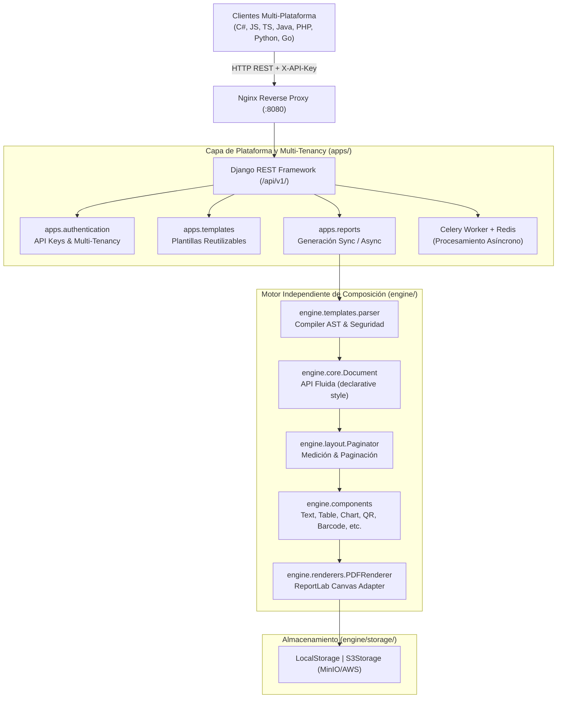

<div align="center">

# 🛠️ ReportForge

### Motor Universal de Composición y Generación de Reportes y Documentos
**Filosofía declarativa •Desarrollado en Python 3.12+, Django REST Framework & ReportLab**

<p align="center">
  <a href="#benchmark"></a>
  <a href="#testing"></a>
  <a href="https://www.python.org/"></a>
  <a href="https://www.djangoproject.com/"></a>
  <a href="https://www.docker.com/"></a>
  <a href="LICENSE"></a>
</p>

<p align="center">
  <b>Genera reportes corporativos impecables sin levantar Chromium ni consumir gigabytes de memoria.</b><br/>
  Consumible como <b>Microservicio REST HTTP universal</b> desde cualquier lenguaje (C#, JavaScript, TypeScript, PHP, Java, Python, Go) o como <b>biblioteca pura de Python</b> con API fluida.
</p>

[⚡ Inicio Rápido](#-inicio-rápido-en-30-segundos) •
[📊 Por qué ReportForge](#-por-qué-reportforge-benchmark) •
[🧱 Motor en Python](#-uso-del-motor-en-python-api-fluida) •
[🌐 API REST](#-api-rest--documentación-openapi) •
[📑 Plantillas JSON](#-plantillas-declarativas-json) •
[💻 Ejemplos Multilenguaje](#-integración-multilenguaje) •
[🐳 Docker](#-despliegue-con-docker)

</div>

---

## ⚡ Inicio Rápido en 30 Segundos

### Opción 1: Con Docker Compose (Recomendado)
Levanta todo el ecosistema (API Gunicorn, Celery Worker, PostgreSQL 16, Redis 7 y Nginx):

```bash
git clone https://github.com/tu-usuario/reportforge.git
cd reportforge
docker compose up -d
```
¡Listo! Abre tu navegador en 👉 **[http://localhost:8080/api/docs/](http://localhost:8080/api/docs/)** para explorar la documentación interactiva Swagger.

#### Genera tu primer PDF en 1 segundo con `curl`:
```bash
curl -X POST http://localhost:8080/api/v1/reports/generate/ \
  -H "Content-Type: application/json" \
  -H "X-API-Key: rf_live_docker_demo_12345" \
  -d '{
    "document": {
      "page": { "size": "A4", "margin": 15 },
      "header": { "type": "text", "value": "MI PRIMER REPORTE", "style": "h2" },
      "content": [
        { "type": "text", "value": "Generado instantáneamente con ReportForge." },
        { "type": "spacer", "height": 10 },
        { "type": "qr", "value": "https://github.com/reportforge", "size": 60 }
      ]
    },
    "response_type": "binary"
  }' \
  --output reporte_rapido.pdf
```

---

## 📊 ¿Por qué ReportForge? (Benchmark)

La mayoría de desarrolladores utilizan herramientas basadas en Chromium headless (Puppeteer, Playwright, jsreport, wkhtmltopdf) para convertir HTML/CSS a PDF. Esto provoca servidores colapsados por memoria y tablas rotas entre saltos de página.

ReportForge utiliza un **motor de composición vectorial nativo** basado en ReportLab con un modelo matemático de cajas:

| Métrica / Capacidad | Motores HTML a PDF (Puppeteer / Chromium) | ReportForge Engine 🛠️ |
| :--- | :--- | :--- |
| **Uso de Memoria RAM** | 🔴 **350 MB - 600 MB** por documento | 🟢 **18 MB - 35 MB** por documento |
| **Tiempo de Generación** | 🔴 **2,200 ms - 4,500 ms** (arranque de Chrome) | 🟢 **90 ms - 180 ms** |
| **Saltos de Página en Tablas** | 🔴 Frecuentes cortes de texto por la mitad | 🟢 **Medición exacta** fila por fila |
| **Repetición de Encabezados** | 🔴 Roto o inconsistente en CSS Paged Media | 🟢 **Automático** (`repeat_header: true`) |
| **Paginación 'Página X de Y'** | 🔴 Requiere hacks complejos en JavaScript | 🟢 **Nativo en dos pasadas exactas** |
| **Independencia de Lenguaje** | 🔴 Requiere Node.js en el backend | 🟢 **Universal vía REST** (PHP, C#, Java, etc.) |
| **Gráficos Integrados** | 🔴 Requiere renderizar Canvas/SVG en navegador | 🟢 **Matplotlib nativo a 200 DPI** |

---

## 🏛️ Arquitectura Desacoplada

ReportForge está diseñado en dos capas estrictamente independientes:



El directorio `engine/` es una **biblioteca de Python 100% pura**, sin ninguna dependencia de Django, bases de datos ni servicios de red.

---

## 🧱 Uso del Motor en Python (API Fluida)

Compone documentos mediante encadenamiento fluido:

```python
from engine import (
    Document, Text, Column, Row, Table, TableColumn,
    Chart, QRCode, Barcode, Spacer, Divider, PageNumber, Typography, Colors
)

doc = Document(title="Factura Comercial")
doc.page(size="A4", orientation="portrait", margin=15)

# Encabezado repetible en cada página
doc.header(
    Row([
        Text("MI EMPRESA S.A.", style=Typography.H2),
        PageNumber(format_str="Página {page} de {total}", alignment="right"),
    ])
)

# Cuerpo del documento
doc.content(
    Column([
        Text("Factura #FAC-2026-001", style=Typography.H1),
        Spacer(10),
        Divider(thickness=1.5, color=Colors.PRIMARY),
        Spacer(15),

        # Tabla con repetición automática de encabezado
        Table(
            columns=[
                TableColumn("Código", width=80),
                TableColumn("Descripción", flex=3),
                TableColumn("Precio", width=90, alignment="right"),
            ],
            data=[
                {"Código": "SRV-01", "Descripción": "Consultoría Cloud", "Precio": "$1,500.00"},
                {"Código": "LIC-02", "Descripción": "Licencia Enterprise", "Precio": "$4,500.00"},
            ],
            header_background=Colors.PRIMARY,
            zebra_color=Colors.BG_ZEBRA,
            repeat_header=True
        ),

        Spacer(15),

        # Gráfico estadístico vectorial y Código QR
        Row([
            Chart(
                chart_type="bar",
                labels=["Q1", "Q2", "Q3", "Q4"],
                values=[12000, 18500, 24000, 31000],
                title="Evolución de Ingresos",
                width=350,
                height=140
            ),
            QRCode("https://verify.miempresa.com/fac/001", size=75),
        ], spacing=15),
    ])
)

# Pie de página dinámico
doc.footer(
    Text("Documento emitido electrónicamente por ReportForge Engine", style=Typography.CAPTION).align_center()
)

# Renderiza y guarda
doc.generate("factura.pdf")
```

---

## 📑 Plantillas Declarativas JSON

Cualquier sistema cliente puede enviar una definición JSON al endpoint `/api/v1/reports/generate/`:

```json
{
  "version": "1.0",
  "document": {
    "page": {
      "size": "A4",
      "orientation": "portrait",
      "margin": 15
    },
    "header": {
      "type": "text",
      "value": "ESTADO DE CUENTA - {{ customer.name }}",
      "style": "h2"
    },
    "content": [
      {
        "type": "text",
        "value": "Cliente: {{ customer.name }} | Fecha de Corte: {{ date | date }}",
        "style": "body"
      },
      { "type": "spacer", "height": 10 },
      {
        "type": "table",
        "source": "movements",
        "columns": [
          { "field": "date", "title": "Fecha", "width": 80, "format": "date" },
          { "field": "concept", "title": "Concepto", "flex": 3 },
          { "field": "amount", "title": "Monto", "width": 90, "format": "currency", "align": "right" }
        ],
        "header_background": "#1E40AF",
        "zebra": true,
        "repeat_header": true
      },
      { "type": "spacer", "height": 15 },
      {
        "type": "qr",
        "value": "https://verify.reportforge.io/{{ hash }}",
        "size": 65
      }
    ],
    "footer": {
      "type": "page_number",
      "format": "Página {page} de {total}",
      "alignment": "right"
    }
  },
  "data": {
    "customer": { "name": "Corporación Caribe S.A." },
    "date": "2026-11-12",
    "hash": "7f8b9a10",
    "movements": [
      { "date": "2026-11-01", "concept": "Depósito en Cuenta Corriente", "amount": 250000.0 },
      { "date": "2026-11-05", "concept": "Pago a Proveedor Lote 45", "amount": -85000.0 }
    ]
  }
}
```

### Formateadores Seguros Integrados
- `{{ valor | currency }}` ➔ `$1,250.50`
- `{{ valor | currency:€ }}` ➔ `€1,250.50`
- `{{ valor | number }}` ➔ `1,250.50`
- `{{ valor | percentage }}` ➔ `18.5%`
- `{{ valor | date }}` ➔ `12/11/2026`
- `{{ valor | uppercase }}` ➔ `TEXTO EN MAYÚSCULAS`

---

## 💻 Integración Multilenguaje

Ejemplos completos y probados ubicados en [`examples/`](examples/):

<details>
<summary><b>🔹 C# (.NET 8+ HttpClient)</b></summary>

```csharp
using System.IO;
using System.Net.Http;
using System.Net.Http.Json;
using System.Threading.Tasks;

using var client = new HttpClient();
client.DefaultRequestHeaders.Add("X-API-Key", "rf_live_secret_key");

var payload = new {
    template = "invoice_template",
    data = new { customer = "Juan Pérez", total = 15000.0 },
    response_type = "binary"
};

var response = await client.PostAsJsonAsync("http://localhost:8080/api/v1/reports/generate/", payload);
byte[] pdfBytes = await response.Content.ReadAsByteArrayAsync();
await File.WriteAllBytesAsync("factura.pdf", pdfBytes);
```
</details>

<details>
<summary><b>🔹 JavaScript / Node.js (Fetch API)</b></summary>

```javascript
import fs from 'fs';

const response = await fetch('http://localhost:8080/api/v1/reports/generate/', {
    method: 'POST',
    headers: {
        'Content-Type': 'application/json',
        'X-API-Key': 'rf_live_secret_key'
    },
    body: JSON.stringify({
        template: 'invoice_template',
        data: { customer: 'Acme Corp', total: 4500.0 },
        response_type: 'binary'
    })
});

const buffer = Buffer.from(await response.arrayBuffer());
fs.writeFileSync('factura.pdf', buffer);
```
</details>

<details>
<summary><b>🔹 TypeScript (Axios)</b></summary>

```typescript
import axios, { AxiosResponse } from 'axios';
import * as fs from 'fs';

const res: AxiosResponse<ArrayBuffer> = await axios.post(
    'http://localhost:8080/api/v1/reports/generate/',
    {
        template: 'estado_cuenta',
        data: { client: 'Banco Global', balance: 89000.0 },
        response_type: 'binary'
    },
    {
        headers: { 'X-API-Key': 'rf_live_secret_key' },
        responseType: 'arraybuffer'
    }
);

fs.writeFileSync('estado_cuenta.pdf', Buffer.from(res.data));
```
</details>

<details>
<summary><b>🔹 PHP 8+ (cURL)</b></summary>

```php
<?php
$ch = curl_init('http://localhost:8080/api/v1/reports/generate/');
$payload = [
    'template' => 'cotizacion',
    'data' => ['customer' => 'Laboratorios Unidos', 'amount' => 4500.0],
    'response_type' => 'binary'
];

curl_setopt($ch, CURLOPT_POSTFIELDS, json_encode($payload));
curl_setopt($ch, CURLOPT_HTTPHEADER, ['Content-Type: application/json', 'X-API-Key: rf_live_secret_key']);
curl_setopt($ch, CURLOPT_RETURNTRANSFER, true);

$pdf = curl_exec($ch);
file_put_contents('cotizacion.pdf', $pdf);
curl_close($ch);
```
</details>

<details>
<summary><b>🔹 Java 17+ (HttpClient)</b></summary>

```java
import java.io.IOException;
import java.net.URI;
import java.net.http.*;
import java.nio.file.*;

public class ReportClient {
    public static void main(String[] args) throws IOException, InterruptedException {
        HttpClient client = HttpClient.newHttpClient();
        HttpRequest request = HttpRequest.newBuilder()
            .uri(URI.create("http://localhost:8080/api/v1/reports/generate/"))
            .header("Content-Type", "application/json")
            .header("X-API-Key", "rf_live_secret_key")
            .POST(HttpRequest.BodyPublishers.ofString(jsonPayload))
            .build();

        HttpResponse<byte[]> response = client.send(request, HttpResponse.BodyHandlers.ofByteArray());
        Files.write(Paths.get("reporte.pdf"), response.body());
    }
}
```
</details>

<details>
<summary><b>🔹 Python (SDK Oficial)</b></summary>

```python
from reportforge_sdk import ReportForgeClient

client = ReportForgeClient(base_url="http://localhost:8080", api_key="rf_live_secret_key")

# Generación automática síncrona o asíncrona
response = client.generate(
    template="invoice_template",
    data={"customer": "Carlos Gomez", "total": 12500.0}
)
response.save("factura.pdf")
```
</details>

---

## 🌐 API REST & Documentación OpenAPI

La API está documentada con **OpenAPI 3 / Swagger**:
- **Swagger UI:** `http://localhost:8080/api/docs/`
- **ReDoc:** `http://localhost:8080/api/redoc/`
- **Esquema JSON:** `http://localhost:8080/api/schema/`

### Endpoints Principales:

| Método | Endpoint | Descripción |
| :--- | :--- | :--- |
| **POST** | `/api/v1/reports/generate/` | Genera un reporte (PDF binario directo o JSON con Celery). |
| **POST** | `/api/v1/reports/preview/` | Previsualización en tiempo real sin guardar en base de datos. |
| **GET** | `/api/v1/reports/{id}/` | Consulta el estado del reporte (`pending`, `completed`, `failed`). |
| **GET** | `/api/v1/reports/{id}/download/` | Descarga el archivo PDF almacenado. |
| **GET/POST** | `/api/v1/templates/` | CRUD de plantillas reutilizables por inquilino. |
| **GET/POST** | `/api/v1/assets/` | Subida de imágenes, logotipos y fuentes TrueType (`.ttf`). |

---

## 🔒 Seguridad y Multi-Tenancy

1. **Aislamiento Multi-Tenancy:** Cada inquilino cuenta con una clave única (`rf_live_...`). Las plantillas y reportes de un inquilino son inaccesibles para los demás.
2. **Cero `eval()` / `exec()`:** El parser de plantillas JSON jamás evalúa código arbitrario.
3. **Protección contra Directory Traversal:** Las rutas a recursos se validan con `validate_safe_path()`, bloqueando accesos con `../`.
4. **Protección de Atributos Privados:** Se bloquea el acceso a atributos mágicos de Python (`__class__`, `__globals__`).

---

## 🐳 Despliegue con Docker

El stack de producción incluye:
- **`nginx`**: Reverse proxy con compresión Gzip en puerto `8080`.
- **`web`**: Servidor WSGI Gunicorn ejecutando Django REST Framework.
- **`worker`**: Tareas asíncronas pesadas con Celery.
- **`db`**: PostgreSQL 16 Alpine.
- **`redis`**: Broker de mensajería en memoria para Celery.

```bash
# Iniciar todos los servicios
docker compose up -d

# Ejecutar migraciones en el contenedor
docker compose exec web python manage.py migrate

# Crear superusuario para el panel de administración
docker compose exec web python manage.py createsuperuser
```

---

## 🧪 Pruebas Automatizadas

El proyecto cuenta con **33 pruebas automatizadas** que cubren medición de cajas, envoltura de texto, división multipágina, tablas cebra, códigos QR/barras, seguridad en plantillas, integración API REST y SDK:

```bash
pytest
============================= 33 passed in 1.71s =============================
```

---

## 📖 Documentación Completa en PDF

ReportForge incluye un **Manual Técnico Oficial de 13 páginas en PDF**, compuesto por el propio motor:
👉 **[`ReportForge_Manual_Oficial_Completo.pdf`](ReportForge_Manual_Oficial_Completo.pdf)**

Puedes regenerarlo cuando desees ejecutando:
```bash
python generate_master_book_pdf.py
```

---

## 📄 Licencia

ReportForge está licenciado bajo la **Licencia MIT**. Siéntete libre de utilizarlo en proyectos comerciales, personales o empresariales.

<div align="center">
  <b>¿Te resulta útil ReportForge? ¡Déjale una ⭐ al repositorio!</b>
</div>
