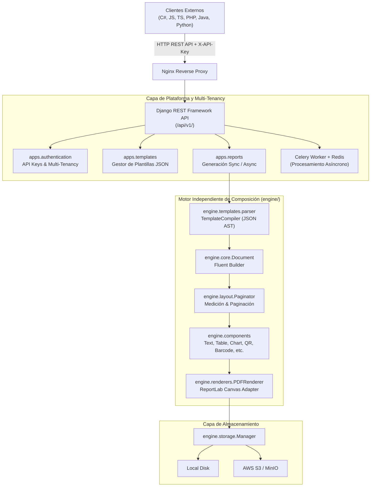

# Arquitectura del Sistema FlowPDF

FlowPDF es un motor profesional de composición y generación de documentos para entornos corporativos y aplicaciones multiplataforma.

Está diseñado con estricta separación de responsabilidades: el **Motor de Composición (Document Engine)** opera como una biblioteca pura de Python, desacoplada de la capa web de **Django REST Framework (DRF)**.



---

## 1. Principios de Diseño del Motor

### A. Composición declarativa
El documento se describe de forma declarativa, no con coordenadas:
- El documento se compone como un árbol jerárquico de nodos (`Component`).
- Se utiliza un modelo de cajas con restricciones (`BoxConstraints`).
- Las dimensiones se calculan previamente (**fase de medición**) antes de ejecutar cualquier comando de dibujo (**fase de renderizado**).
- No depende de coordenadas absolutas fijas. Los elementos fluyen naturalmente ocupando el espacio disponible (`flex`, `constant_item`, `auto_item`).

### B. Sistema de Coordenadas Top-Down
ReportLab nativamente utiliza un sistema cartesiano con origen `(0, 0)` en la esquina inferior izquierda (creciendo hacia arriba). Esto suele generar errores matemáticos complejos en diseños modernos.

FlowPDF introduce `DrawContext` que normaliza todas las coordenadas al estándar moderno **Top-Left**:
- `(0, 0)` está en la esquina superior izquierda del área de contenido.
- `x` crece hacia la derecha.
- `y` crece hacia abajo.
- La transformación a coordenadas ReportLab se realiza automáticamente:
  $$\text{canvas\_y} = \text{page\_height} - y - \text{height}$$

### C. Algoritmo de Paginación y Repetición de Encabezados
1. **Cálculo del presupuesto de página**:
   $$\text{Presupuesto Alto} = \text{Alto de Contenido} - (\text{Alto Encabezado} + \text{Espaciado}) - (\text{Alto Pie} + \text{Espaciado})$$
2. **Medición predictiva**: Si el componente raíz (`Column`, `Table`) no cabe en el presupuesto actual, se invoca `component.split(available_height)`.
3. **División de Tablas (`Table.split`)**:
   - Calcula cuántas filas de datos caben en el espacio restante.
   - Genera una partición con las filas que caben en la página actual.
   - Genera una segunda partición con las filas restantes para la siguiente página.
   - Si `repeat_header=True`, ambas particiones conservan el encabezado original de columnas, repitiéndose automáticamente en cada página sin duplicar datos.

---

## 2. Aislamiento Multi-Tenancy

Cada cliente o microservicio que consume FlowPDF se identifica mediante un encabezado HTTP:
```http
X-API-Key: rf_live_...
```
El modelo `Application` representa al inquilino (tenant):
- **Plantillas aisladas**: Una aplicación solo puede consultar, modificar y usar sus propias plantillas.
- **Reportes aislados**: Los identificadores de reportes y las URLs de descarga están estrictamente restringidos al inquilino emisor.
- **Cuotas de generación**: Soporta control de tasa de solicitudes (`rate_limit_per_minute`).

---

## 3. Seguridad Estricta en Plantillas

- **Cero Ejecución Arbitraria**: El motor no utiliza `eval()`, `exec()` ni introspección insegura de Python.
- **Interpolación Segura**: Las variables se resuelven mediante `get_nested_value()` que bloquea atributos privados (como `__class__`, `__globals__`).
- **Validación de Rutas**: Toda referencia a archivo pasa por `validate_safe_path()`, bloqueando ataques de *Directory Traversal* (`../`).
